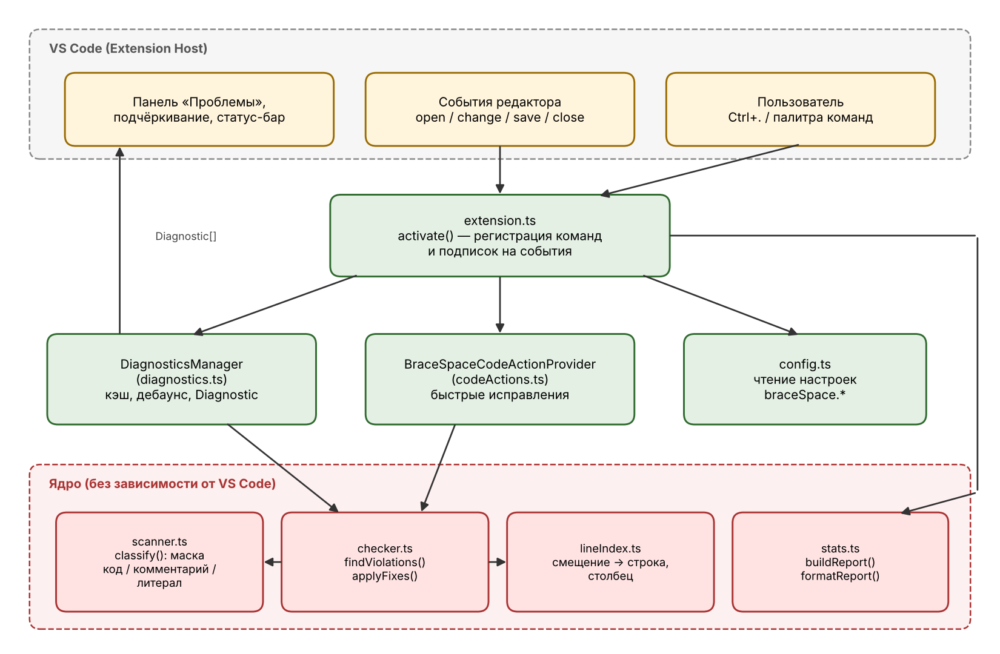
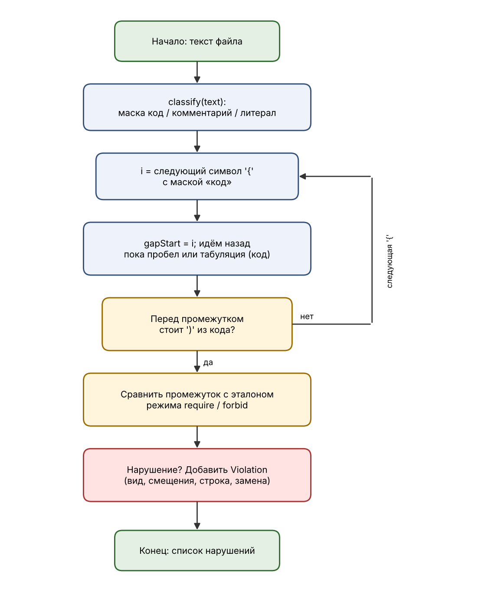

# Документация Brace Space Checker (Надточий Ярослава м3119)

## 1. Назначение

Плагин для VS Code находит в исходном коде места, где нарушено правило: между `)` и `{` должен быть ровно один пробел. Работает с C, C++ и Java, умеет подсвечивать нарушения, исправлять их по одному и целым файлом, строить отчёты.

## 2. Архитектура

Проект разделён на два слоя.

1. **Слой интеграции с VS Code** (`extension.ts`, `diagnostics.ts`, `codeActions.ts`, `config.ts`). Работает с API `vscode`: подписки на события, диагностики, команды, настройки, строка состояния.
2. **Ядро** (`scanner.ts`, `checker.ts`, `lineIndex.ts`, `stats.ts`, `types.ts`). Чистые функции, не зависящие от VS Code. Благодаря этому ядро тестируется обычным Node.js без запуска редактора.

### Жизненный цикл расширения

- VS Code активирует расширение, когда открывается файл на `c`, `cpp` или `java` (`activationEvents` в `package.json`) и вызывает `activate()`.
- `activate()` создаёт `DiagnosticsManager`, регистрирует три команды, поставщика быстрых исправлений и подписывается на события редактора. Все созданные объекты складываются в `context.subscriptions`, и VS Code сам освобождает их при выгрузке.
- При открытии и сохранении файла проверка запускается сразу, при наборе текста — с задержкой 300 мс (дебаунс), чтобы не пересчитывать файл после каждого символа.

## 3. Алгоритм

1. `classify(text)` за один проход размечает каждый символ как код, комментарий или литерал. Это конечный автомат с состояниями: однострочный комментарий (с учётом склейки строк через `\`), блочный комментарий, строка и символ (с учётом `\`-экранирования), сырая строка C++ `R"delim(...)delim"`. Апостроф внутри числа (`1'000`) кавычкой не считается.
2. `findViolations` перебирает текст; для каждой `{` из кода идёт назад по пробелам и табуляциям той же строки. Если дальше стоит `)` из кода, промежуток сравнивается с эталоном режима:
   - `require`: пусто → `missing`, не ровно один пробел → `extra`;
   - `forbid`: непусто → `forbidden`.
3. Для каждого нарушения запоминаются смещения скобок и промежутка, строка, столбец и строка замены. Их достаточно, чтобы подчеркнуть место и исправить его без повторного разбора.
4. `applyFixes` собирает новый текст из кусков между нарушениями и замен.

Сложность: время O(n), память O(n) (маска символов размером с файл).

## 4. Структуры данных

| Структура | Где | Зачем |
|---|---|---|
| `Uint8Array` (маска символов) | `scanner.ts` | компактная разметка «код / комментарий / литерал», доступ к классу символа за O(1) |
| `Set<string>` | `config.ts`, `scanner.ts` | быстрая проверка языка документа и префиксов сырых строк |
| `number[]` (отсортированные начала строк) + двоичный поиск | `lineIndex.ts` | перевод смещения в строку и столбец за O(log n) |
| `Violation[]` | `checker.ts` | результат проверки, порядок совпадает с порядком в тексте |
| `Map<ViolationKind, number>` | `stats.ts` | счётчики по видам нарушений |
| `Map<number, Violation[]>` | `stats.ts` | нарушения, сгруппированные по строкам (порядок вставки сохраняется) |
| `Map<string, Violation[]>` | `diagnostics.ts` | кэш результатов по URI документа |
| `Map<string, Timeout>` | `diagnostics.ts` | таймеры дебаунса по URI документа |

## 5. Описание модулей и функций

### types.ts
- `Mode` — `'require' | 'forbid'`.
- `ViolationKind` — `'missing' | 'extra' | 'forbidden'`.
- `Violation` — описание нарушения (смещения `parenOffset`, `gapStart`, `gapEnd`, `bracePos`, позиция `line`/`column`, строка замены `replacement`).

### scanner.ts
- `CharClass` — константы `Code`, `Comment`, `Literal`.
- `classify(text): Uint8Array` — размечает текст.

### lineIndex.ts
- `new LineIndex(text)` — строит индекс начал строк.
- `lineOf(offset)`, `columnOf(offset)`, `lineCount`.

### checker.ts
- `findViolations(text, options): Violation[]` — поиск нарушений.
- `applyFixes(text, violations): string` — применение исправлений.

### stats.ts
- `buildReport(violations): Report` — сводка (`total`, `byKind`, `byLine`).
- `formatReport(title, report): string` — текст для окна вывода.
- `KIND_TITLES` — тексты сообщений по видам нарушений.

### config.ts
- `readSettings(): Settings` — актуальные настройки `braceSpace.*`.

### diagnostics.ts
- `DiagnosticsManager`:
  - `isSupported(doc)` — подходит ли язык и размер файла;
  - `analyze(doc)` — посчитать нарушения прямо сейчас;
  - `refresh(doc)` — проверить и обновить подчёркивания;
  - `schedule(doc)` — то же с задержкой (дебаунс);
  - `refreshAll()`, `clear(doc)`, `getViolations(doc)`, `dispose()`;
  - событие `onDidUpdate` — для обновления строки состояния.

### codeActions.ts
- `BraceSpaceCodeActionProvider.provideCodeActions` — предлагает быстрые исправления для наших диагностик и общий вариант «исправить всё».
- `buildFixEdit(doc, violations)` — собирает `WorkspaceEdit`.

### extension.ts
- `activate(context)` — регистрация команд и подписок.
- `deactivate()` — пустая, ресурсы освобождаются через `context.subscriptions`.

## 6. Команды и настройки

См. таблицы в [README.md](../README.md).

## 7. Тестирование

Интеграцию с VS Code проверяют вручную на файлах из `sample/`.
